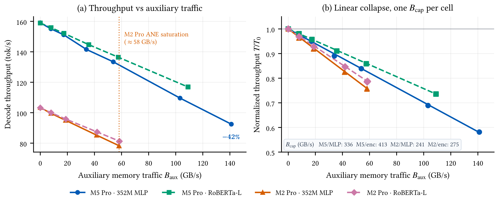
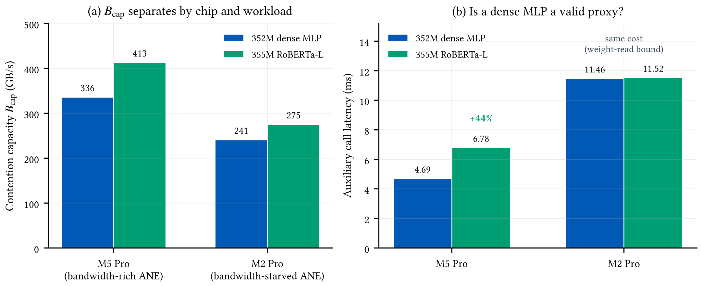
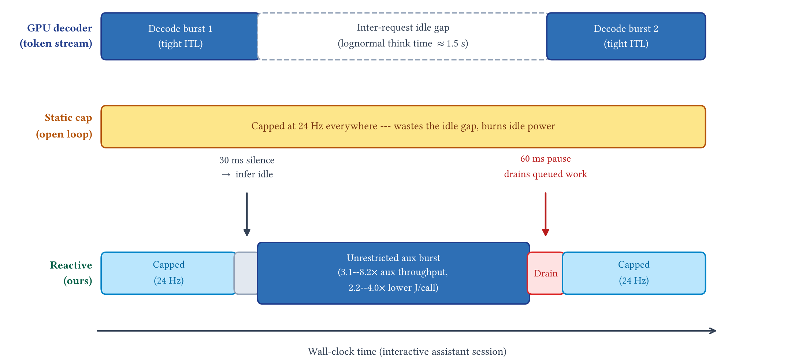
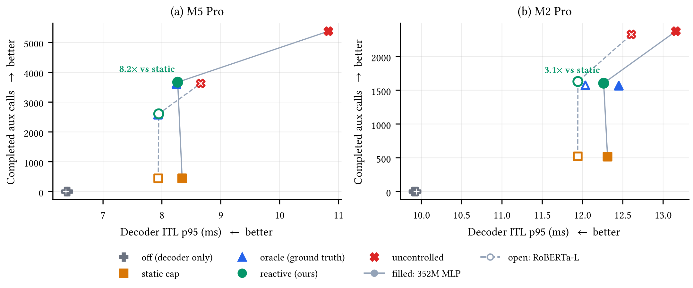
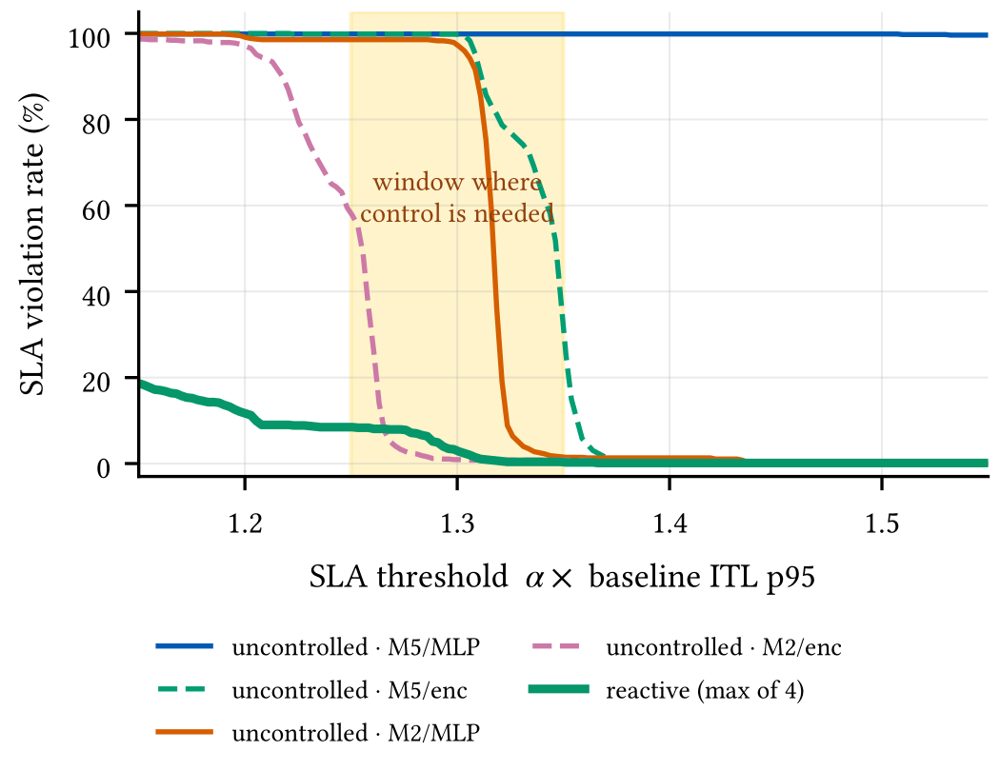
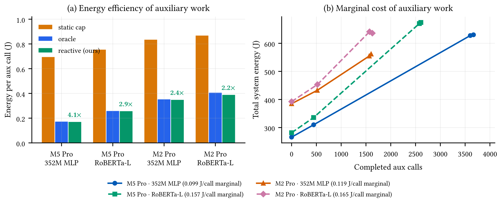

An assistant that runs on your own device rarely runs one model. A chat model writes the reply. A smaller model decides which tool to call. Another one filters unsafe output. Another one searches your notes or reads your screen. To save battery, the system often puts the chat model on the GPU and the helper models on the Neural Engine (ANE), the part of the chip built for small neural networks.

That arrangement has a catch. On Apple Silicon, the GPU and the ANE do not have their own memory. They share one pool. When both read their model weights at the same moment, they queue up for the same memory channels.

I wanted to know how much that costs the chat model, and whether a scheduler can reduce the cost. This post is what I found, written for people who do not work on this every day. The short version:

- Two models running together can slow the chat model by up to **42%**.
- The damage shows up first in the **worst tokens**, not the average. At light load, the median barely moves while the slowest 5% of tokens get 24% to 30% slower.
- The slowdown follows a **simple line**: the chat model keeps whatever share of memory bandwidth the helper models leave behind.
- A scheduler that watches token timing, and uses the idle gaps in a conversation, completes **3.1 to 8.2 times more helper work** than a fixed rate cap, with no loss of smoothness.

## What "one memory pool" means

In most computers, the processor and the graphics chip have separate memory. Moving data between them costs a copy, and that copy costs time and power. Apple Silicon removes it. The CPU, the GPU, and the ANE all read one pool of memory. That is why a helper model on the ANE can read a buffer the GPU just wrote, with no copying at all.

The same design has a cost. All three units draw from the same memory channels. Think of one pipe feeding several taps. Each tap can be wide open on its own. Open them together, and each one gets a smaller stream. When the ANE streams its weights while the GPU streams its weights, the two streams meet in the middle and neither gets the bandwidth it wanted.

## Why writing a reply is really a memory job

A large language model writes a reply one token at a time. A token is a small piece of a word, roughly three quarters of a word.

To produce a single token, the model must read every one of its weights out of memory. It reads the whole model, every time, for every token. For a 2.6-billion-parameter model at 4-bit precision, that is about 1.4 GB read per token. The arithmetic per token is small. The reading is not.

So the speed of a reply depends on one thing: how much memory bandwidth the GPU can get. If helper models take part of that bandwidth, the reply slows down. Nothing is broken. The models are simply sharing a finite resource.

## The number users actually feel

People do not experience average speed. They experience the worst moments. If nineteen tokens arrive quickly and the twentieth arrives late, the reply feels like it stuttered, even though the average was fine.

So I track two numbers for the gap between tokens:

- The **median** gap. Half the tokens are faster than this.
- The **p95** gap. Only 5% of tokens are slower than this.

The p95 is the one that decides whether a reply feels smooth. As the results below show, it is also the number that reacts first when two models compete.

## Four ways to measure this wrong

Interference between two accelerators is easy to measure incorrectly. I made four mistakes before the numbers made sense. Each one changed a result, and one of them changed a conclusion. I describe them because anyone repeating this work will meet the same traps.

### 1. A background Python thread measures Python, not the hardware

My first version ran the helper model in a background Python thread. The results were nonsense: the same setup gave a median latency of 47 ms one minute and 724 ms the next, against a baseline of 6.29 ms. That is a spread of about 15 times.

The cause was not memory contention. Python has a global interpreter lock (GIL): only one thread runs Python bytecode at a time. My two models were taking turns inside Python, not competing for memory. To prove it, I forced the helper model to run on the CPU instead of the ANE. The slowdown was the same.

The fix is to run the helper model in a separate process. After that, run-to-run variation dropped below 1%.

### 2. The power sensor for the ANE does not exist, and the one that does lags

macOS ships a tool called `powermetrics`. It reports CPU power and GPU power. It does not report ANE power at all, even when the ANE is running 200 times per second. A power measurement that only watches the GPU rail misses the ANE completely.

To get total power for the whole machine, I wrote a small C tool that reads the `PSTR` key from the AppleSMC sensor directly. It does not need root. That sensor has its own quirks:

- It updates about once per second, even when sampled ten times per second.
- It lags the real load by about 2.3 seconds on the M5 Pro and 1.9 seconds on the M2 Pro.

So a short one-second benchmark gives a bad energy number. I run each test for 20 seconds or more and integrate the power over the whole window.

### 3. A busy desktop changes the answer

My first runs were on a laptop with the screen on. The window compositor was using the GPU, and idle power was about 9 W. Under that load, the decoder reached 147.3 tokens per second at 4-bit precision.

Then I closed the background apps, put the display to sleep, and ran everything over SSH. Idle power fell to 2.7 W on the M5 Pro, and the decoder reached 158.8 tokens per second. Background activity is not just noise. It uses memory bandwidth, and it changed the measured speed by about 8%.

### 4. Drift and pooling create effects that are not there

Over a session of several hours, the machine's baseline drifts by up to 9%, because of heat and clock speeds. If you fit a line to raw, unnormalized numbers, you can "discover" an effect that does not exist. One of my raw sweeps gave an R² of 0.095 and suggested a fake super-linear trend. Another mistake, pooling two different helper models into one fit, once suggested the wrong shape for the curve.

The protocol that avoids this: measure the no-load baseline for each sweep, normalize against it, average three repeats per condition, and fit each (chip, helper model) pair on its own.

## The test setup

I measured on two chips and with two helper models, for four combinations in total.

- **Chips.** An Apple M5 Pro laptop (24 GB, macOS 26.6.1, display asleep) and an Apple M2 Pro Mac mini in the cloud (macOS 26.7.1, headless).
- **The chat model.** `LFM2.5-2.6B`, on the GPU, at 4-bit and 8-bit precision. Each request writes 64 tokens.
- **Helper models.** Two models of similar size, both on the ANE:
    1. A plain dense network (352M parameters) — four large matrix multiplications in a row.
    2. A real text encoder, `roberta-large` (355M parameters) — the kind of model an assistant uses to read a prompt or search notes.

I used one plain model and one real one on purpose, to check whether a cheap stand-in model gives honest numbers.

| Cell | Chip | Helper model | Call time (ms) | Weight-read speed (GB/s) |
| --- | --- | --- | --- | --- |
| A | M5 Pro | dense network | 4.69 | 150.3 |
| B | M5 Pro | RoBERTa | 6.78 | 104.9 |
| C | M2 Pro | dense network | 11.46 | 61.5 |
| D | M2 Pro | RoBERTa | 11.52 | 61.7 |

Before the main experiments, I checked the harness against published numbers for the M2 Pro from MacPaw Research. Their ANE reached 60.4 GB/s of weight-read speed; mine reached 61.5 to 61.7. Their 4-bit decoder reached about 100 tokens per second; mine reached 103.3. Close enough to trust the rest.

## Finding 1: a cheap stand-in model is honest on a slow chip

This one surprised me.

On the M2 Pro, the fancy text encoder and the plain network take almost the same time: 11.52 ms against 11.46 ms. That is a 0.5% difference. Two very different models, same cost.

The reason is that the M2 Pro's ANE tops out at about 61 GB/s of weight reads. Both models are limited by reading their weights, not by computing. The encoder's extra work (24 attention layers, normalization, and more) is completely hidden behind the waiting.

On the M5 Pro, the story changes. Its ANE sustains 150 GB/s, so the weights arrive quickly and the encoder's computation becomes visible. The encoder takes 44% longer than the plain network.

The lesson is practical for anyone benchmarking a neural chip: on a bandwidth-limited chip, a cheap model tells the truth. On a fast chip, it flatters you.

## Finding 2: how much the chat model loses

I ran the chat model alone, then added the helper model at seven increasing rates, from idle to as fast as it would go. The helper model competes for memory, so I plot the result against the memory traffic it actually achieved, not against the rate I asked for.

<figure>

<figcaption>(a) Chat model speed against the helper model's memory traffic. The M5 Pro loses up to 42% (plain network) and 26% (encoder). The M2 Pro's ANE saturates at about 58 GB/s, so its loss is capped at 24% and 22%. (b) The same data, normalized. It falls on a straight line in all four setups.</figcaption>
</figure>

Three things stood out.

**The worst tokens go first.** At a light helper rate, the median gap between tokens moves by less than 0.8% in every setup. But the p95 gap jumps immediately, by 24% to 30%. One helper weight burst can collide with one token step and create a visible stutter. On average, nothing looks wrong.

**The M2 Pro's ANE has a ceiling.** Past 96 calls per second, the M2 Pro's ANE stops going faster. Extra requests add no traffic. Because the traffic is capped, the damage is also capped, at about 24%. The M5 Pro's ANE is faster. It can push 141 GB/s into the memory system, and the chat model loses up to 42%. A faster helper chip can hurt more, not less.

**It is memory traffic, not process overhead.** I ran three controls. An idle process alongside the decoder changed its speed by 0.0%. A pure memory-copy loop on the CPU cost 6.6%. A helper model at the same rate cost 8.6%. The cost comes from moving bytes, and the ANE adds a little extra variance on top.

For readers who want the full numbers, here is every measurement. Each row is the helper traffic it achieved, the chat model's speed, and the p95 gap in brackets.

| Requested rate | A: M5 / plain | B: M5 / encoder | C: M2 / plain | D: M2 / encoder |
| --- | --- | --- | --- | --- |
| off | 0.0, 159.1 [6.48] | 0.0, 158.9 [6.44] | 0.0, 103.4 [10.02] | 0.0, 103.2 [10.07] |
| 12 Hz | 7.9, 155.1 [8.38] | 8.0, 155.9 [7.97] | 7.9, 99.6 [12.61] | 8.0, 100.0 [12.26] |
| 32 Hz | 17.3, 151.2 [8.41] | 17.5, 152.1 [8.06] | 18.7, 95.0 [12.63] | 18.9, 95.8 [12.29] |
| 64 Hz | 34.0, 141.6 [8.71] | 35.8, 144.7 [8.19] | 41.6, 85.3 [12.82] | 42.0, 87.3 [12.44] |
| 96 Hz | 53.9, 133.4 [8.64] | 57.6, 136.5 [8.13] | 58.1, 78.3 [13.23] | 58.5, 81.3 [12.80] |
| 160 Hz | 103.2, 109.6 [10.17] | 109.0, 116.9 [8.77] | 58.1, 78.3 [13.27] | 58.4, 81.2 [12.80] |
| ∞ | 141.1, 92.5 [11.24] | 109.1, 116.9 [8.75] | 58.1, 78.2 [13.45] | 58.3, 81.0 [12.93] |

<strong>How to read this table.</strong> Each cell holds three values: helper memory traffic in GB/s, chat model speed in tokens per second, and the p95 gap between tokens in milliseconds. Every row is the average of three repeats.

## The simple rule

All of the above fits one line:

$$T/T_0 = 1 - B_\mathrm{aux}/B_\mathrm{cap}$$

In words: the chat model keeps the share of memory bandwidth that the helper models leave behind. $T$ is the chat model's speed with helpers running, $T_0$ is its speed alone, and $B_\mathrm{aux}$ is the helper model's memory traffic.

$B_\mathrm{cap}$ is the size of the budget. It is the traffic at which the chat model would slow to a stop. It is not a fixed hardware number. It depends on the chip, and it also shifts with the helper model:

<figure>

<figcaption>(a) The budget constant $B_\mathrm{cap}$ splits cleanly by chip, and shifts a little with the helper model. (b) The plain network and the encoder take almost the same time on the M2 Pro, but the encoder is 44% slower on the M5 Pro.</figcaption>
</figure>

| Setup | Fit quality ($R^2$) | Error | Exponent $k$ | Budget $B_\mathrm{cap}$ (GB/s) |
| --- | --- | --- | --- | --- |
| A: M5 / plain | 0.9995 | 0.0033 | 1.00 | 335.7 |
| B: M5 / encoder | 0.9999 | 0.0010 | 1.00 | 412.8 |
| C: M2 / plain | 0.9998 | 0.0014 | 1.00 | 240.7 |
| D: M2 / encoder | 0.9998 | 0.0013 | 1.00 | 275.0 |

A few things worth noting.

**The line fits almost perfectly.** In all four setups, $R^2$ is 0.9995 or better. I also tried two other shapes: a power law with a free exponent, and a queueing-style curve. The power law's free exponent settled on exactly 1.00, which means it collapsed back into the same straight line and paid for an extra parameter that did nothing. The queueing curve was worse in all four setups.

**The chip sets the budget.** The M5 Pro's budget is 336 to 413 GB/s. The M2 Pro's is 241 to 275 GB/s. The M5 Pro has roughly 1.4 to 1.5 times more room.

**The helper model matters too.** On the same chip, the encoder gets a 14% to 23% larger budget than the plain network. My guess is that the encoder's attention and normalization work breaks up its memory requests, so each byte is a little less demanding than a long run of matrix multiplications. I only have two models, so this is an observation, not a proven mechanism.

**The practical rule.** To keep 95% of the chat model's speed, the M5 Pro can afford 17 to 21 GB/s of helper traffic, which is about 24 to 29 helper calls per second. The M2 Pro can afford 12 to 14 GB/s, about 17 to 19 calls per second.

## Why a fixed rate cap wastes the machine

The rule above suggests an easy fix. Work out the safe rate, then cap the helper models at it, always. I tried that. It worked, but it wasted most of the machine.

Here is why. An assistant is bursty. It writes for a second or two, then goes quiet for a second or two while you read or type. A fixed cap throttles the helper models during the quiet time too, when nothing is competing with them.

I also tried an adaptive controller that watches latency and adjusts the rate on its own. That failed as well. On a steady workload, the fixed cap already met the target, so there was nothing to improve. The adaptive controller either overshot the target or collapsed to five calls per second.

The problem is not the rate. The problem is that the rate is the same in both phases of a conversation.

## The scheduler: watch the gaps, not the engine

A scheduler on a phone cannot look inside the inference engine. It cannot ask the model what it is doing, and it cannot interrupt a helper model that has already started on the ANE. But it can watch one thing: when tokens come out.

Tokens normally arrive every 6 to 13 ms. So if 30 ms pass with no token, the assistant must be idle. That single observation is enough.

<figure>

<figcaption>How each approach uses one conversation. A fixed cap holds one rate for the whole session, so the quiet gap is wasted. The scheduler caps helper work while tokens are coming out, releases it after 30 ms of silence, and pauses for 60 ms when writing resumes so that queued work drains. The 30 ms and 60 ms windows are drawn wider than scale here: a real 30 ms window next to a 1.5 s gap is a ratio of about 1 to 50.</figcaption>
</figure>

The scheduler has three rules:

1. **Watch for silence.** After 30 ms with no token, the assistant is idle. Let the helper models run freely.
2. **Cap during writing.** When a token appears, the assistant is writing again. Cap the helper rate at the safe value from the cost model.
3. **Pause to drain.** Core ML, the framework that runs models on the ANE, queues work asynchronously. Lowering the rate does not cancel the calls already waiting. So when writing resumes, the scheduler pauses new helper submissions for 60 ms and lets the queue empty. Without this pause, queued helper calls land on the first tokens of the new reply. With it, boundary violations dropped by about an order of magnitude, and no helper throughput was lost.

That is the whole design. No changes to the inference engine, no privileged access, no knowledge of what the models are doing.

## Results

I compared five approaches across all four setups: the chat model alone, helper models running flat out, a fixed cap, an "oracle" that knows the true phase in advance, and the scheduler.

In every setup, the scheduler completed far more helper work than the fixed cap, at the same or lower p95 gap.

- **M5 Pro, plain network:** 3,668 helper calls against 445. That is 8.2 times more work, at a slightly lower p95 (8.27 ms against 8.34 ms). The chat model kept 96% of its no-helper speed.
- **M5 Pro, encoder:** 2,607 calls against 444, or 5.9 times more, at the same p95. Fewer calls fit, because each encoder call takes 44% longer on this chip.
- **M2 Pro, both models:** 1,604 and 1,629 calls against 517 and 521, or 3.1 times more, at equal or lower p95.

The scheduler also matched the oracle closely: within 1.5% to 3.6% on helper throughput. Watching token silence is enough to capture almost all of the benefit of knowing the true phase.

<figure>

<figcaption>Helper calls completed against the chat model's p95 token gap. Up and to the left is better: more helper work, less stutter. The scheduler sits in the same corner as the oracle.</figcaption>
</figure>

Here is the full comparison. The "violation" column is the share of tokens that miss a latency target set at 1.3 times the no-load p95.

| Setup | Approach | p50 (ms) | p95 (ms) | tok/s | Over target | Helper calls | Energy per call |
| --- | --- | --- | --- | --- | --- | --- | --- |
| A: M5 / plain | chat alone | 6.32 | 6.41 | 158.3 | 0.0% | 0 | -- |
| | uncontrolled | 10.76 | 10.83 | 93.0 | 99.9% | 5,377 | 0.147 J |
| | fixed cap | 6.33 | 8.34 | 151.3 | 5.2% | 445 | 0.696 J |
| | oracle | 6.34 | 8.25 | 151.9 | 2.4% | 3,604 | 0.174 J |
| | scheduler | 6.34 | 8.27 | 152.0 | 2.9% | 3,668 | 0.172 J |
| B: M5 / encoder | chat alone | 6.30 | 6.37 | 158.8 | 0.0% | 0 | -- |
| | uncontrolled | 8.57 | 8.66 | 117.1 | 99.7% | 3,625 | 0.226 J |
| | fixed cap | 6.34 | 7.94 | 153.1 | 0.0% | 444 | 0.756 J |
| | oracle | 6.35 | 7.93 | 153.3 | 0.0% | 2,577 | 0.260 J |
| | scheduler | 6.34 | 7.95 | 153.3 | 0.3% | 2,607 | 0.259 J |
| C: M2 / plain | chat alone | 9.68 | 9.90 | 103.2 | 0.0% | 0 | -- |
| | uncontrolled | 13.06 | 13.16 | 76.7 | 97.5% | 2,373 | 0.270 J |
| | fixed cap | 9.78 | 12.31 | 96.9 | 0.3% | 517 | 0.837 J |
| | oracle | 9.85 | 12.45 | 96.2 | 0.0% | 1,566 | 0.354 J |
| | scheduler | 9.86 | 12.26 | 96.2 | 0.3% | 1,604 | 0.350 J |
| D: M2 / encoder | chat alone | 9.69 | 9.94 | 103.0 | 0.0% | 0 | -- |
| | uncontrolled | 12.37 | 12.61 | 80.8 | 0.9% | 2,325 | 0.323 J |
| | fixed cap | 9.77 | 11.94 | 97.4 | 0.0% | 521 | 0.870 J |
| | oracle | 9.81 | 12.03 | 97.0 | 0.3% | 1,572 | 0.408 J |
| | scheduler | 9.78 | 11.94 | 97.4 | 0.0% | 1,629 | 0.390 J |

<strong>About the latency target.</strong> An absolute target does not transfer between machines. The M5 Pro's no-load p95 is 6.41 ms, and the M2 Pro's is 9.90 ms, so a fixed 10 ms target is easy on one machine and impossible on the other. I use 1.3 times each machine's own no-load p95.

## When you actually need this

Not every app needs a scheduler. The measurements point to three zones.

**Below 1.2 times the no-load p95: do not run helper models while writing.** The budget is too tight. Even a capped helper model produces occasional stutters. Helper work has to wait for the quiet gaps.

**1.25 to 1.35 times: this is where control matters.** In this band, running helper models with no control breaks the target on 58% to 100% of tokens. The scheduler holds that to 0% to 2.9%.

**Above 1.5 times: you can often skip the scheduler.** In three of the four setups, even uncontrolled helper models meet the target, because the memory system has enough headroom. The chat model is still 22% to 26% slower on average, though, so you pay in speed even when you meet the deadline.

<figure>

<figcaption>Share of tokens that miss the target, as the target gets looser. The shaded band is 1.25 to 1.35 times the no-load p95. Inside it, uncontrolled helper models fail in all four setups, while the scheduler stays near zero. Below the band, no approach meets the target. Above it, even no control is fine.</figcaption>
</figure>

## Energy: the machine pays for idle time anyway

The energy result is the most striking part, and it comes from a simple observation.

Over a 22 to 25 second session, the chip spends 282 to 389 joules even when the helper models do nothing. That energy covers the writing bursts and the quiet gaps. The machine is paying for the idle time regardless.

A fixed cap burns that same idle energy but completes very few helper calls. The scheduler uses the same quiet gaps, so each extra call is cheap: 0.10 to 0.17 joules, against 0.70 to 0.87 joules under a fixed cap. That is 2.2 to 4.0 times less energy per helper call.

<figure>

<figcaption>(a) Energy per completed helper call. The scheduler uses 4.0, 2.9, 2.4, and 2.2 times less than a fixed cap across the four setups. (b) Total session energy against calls completed. The chip spends 282 to 389 joules even with no helper work, so extra calls that fill existing quiet gaps cost only 0.10 to 0.17 joules each.</figcaption>
</figure>

## Where this fits

Mobile systems such as Band, MASA, Pantheon, and HaX-CoNN schedule several neural networks across a phone's CPU, GPU, and NPU. Those systems target stateless workloads, like processing video frames one by one, and they optimize average throughput or frame deadlines. A chat model is different. It is stateful, it reads all its weights for every token, users judge it on the worst tokens rather than the average, and its quiet gaps are an opportunity rather than dead time.

MacPaw Research measured LLM execution on the ANE and reported a similar effect: a router on the ANE, running beside a GPU decoder, cut the decoder's speed by about 20%. They treated that as a reason to keep the two apart with static placement. This work measures the effect in detail, turns it into a formula, and then uses the formula to schedule the helper models at run time instead.

Other on-device LLM work, such as LLM in a Flash, MobileLLM, and speculative decoding, reduces the cost of running one model. That is a different problem from sharing the machine between several.

## What I still do not know

- **My helper load never stopped.** In the trace experiments, the helper models always had work waiting. That is the worst case for a scheduler and the best case for leaving things uncontrolled, because uncontrolled work runs at full speed in both phases. Real assistants are burstier: a few context chunks per turn, not a continuous stream. A real workload should favor the scheduler more, not less.
- **The two machines ran different macOS versions.** The M5 Pro ran macOS 26.6.1 and the M2 Pro ran macOS 26.7.1. I pinned the Python, MLX, Core ML, and PyTorch versions on both, but small scheduler differences cannot be ruled out. Read the chip comparisons as trends, not as a strict ranking.
- **Not every encoder converts to Core ML.** `roberta-large` and `distilbert` convert with more than 95% of their operations on the ANE. With `coremltools` 9.0, `bert-base` and `electra` do not convert at all, because of an unsupported integer cast in the token-type embedding.
- **The think times are synthetic.** The quiet gaps come from a random distribution with a mean of 1.5 seconds. Replaying real assistant traces, with real prompt lengths, is the obvious next step.
- **The budget constant comes from one run per setup.** Each rate condition averages three repeats and the fit is excellent, but more runs would give a confidence interval on $B_\mathrm{cap}$.
- **Prefill is not protected.** The scheduler needs a token before it knows writing has started. Before the first token, it thinks the machine is idle and leaves the helper models unrestricted. Prefill is compute-heavy rather than memory-heavy, so the effect looks small, but I did not measure it carefully.

## Takeaways

- When a chat model and helper models share Apple Silicon's memory, the chat model can lose up to 42% of its speed.
- The damage appears in the worst tokens first. At light load, the median barely moves while the slowest 5% of tokens get 24% to 30% slower.
- The slowdown follows a straight line: the chat model keeps the share of memory bandwidth the helpers leave behind. One constant, $B_\mathrm{cap}$, captures the chip and the helper model.
- A fixed rate cap is safe but wasteful, because it throttles the helpers during the quiet gaps of a conversation.
- Watching token timing is enough. A scheduler that releases helper work after 30 ms of silence, and pauses for 60 ms when writing resumes, completes 3.1 to 8.2 times more helper work than a fixed cap, at the same or lower stutter, and uses 2.2 to 4.0 times less energy per call.
- Control matters most in a narrow band: when the latency budget is 1.25 to 1.35 times the no-load p95.

## Artifact and reproducibility

All experiments ran on real Apple M5 Pro and M2 Pro hardware. Every number and figure above comes from recorded telemetry. The measurement harness, the experiment scripts, and the raw results are public at [github.com/bashketchum02/npu-ane-bench](https://github.com/bashketchum02/npu-ane-bench). The harness covers the protocol, the timing, the whole-machine power readings, the statistics, and the scheduler.

Generative AI tools helped write the benchmark and plotting code, and helped edit this post.
